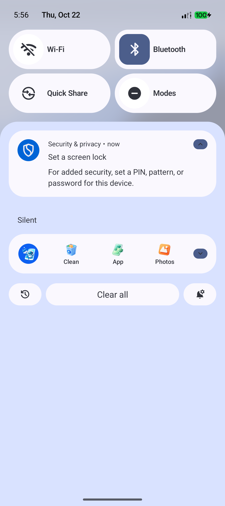

# 开机恢复与 Grouping 验证

日期：2026-10-22。仅 localDebug；未构建/安装 google 渠道，未操作连接的实体设备。

## 静态、编译与单元测试

执行 `:notification:testLocalDebugUnitTest :app:testLocalDebugUnitTest :notification:lintLocalDebug :app:lintLocalDebug :app:assembleLocalDebug :app:assembleLocalDebugAndroidTest :notification:assembleLocalDebugAndroidTest`。

- notification：149 项通过，0 失败；含新增开机准入、重复开机、前台解除阻塞的 10 项。
- app：373 项通过，0 失败；含新增 Grouping 空值、原样字符串、远程等待、A→B→A、并发去重、上报未就绪/失败、页面取消覆盖（6 个测试方法）。
- 两模块 Lint 均 0 Error；仓库现有 Warning 仍有保留，新增持久写入的 UseKtx 建议因需要检查 `commit()` 结果保留同步提交（在 IO 执行）。
- 最终合并 Manifest 包含 `RECEIVE_BOOT_COMPLETED`、`FOREGROUND_SERVICE`、`FOREGROUND_SERVICE_SPECIAL_USE`、`POST_NOTIFICATIONS`；`BootCompletedReceiver` 为 exported=false，仅匹配 `BOOT_COMPLETED`。
- `git diff --check` 通过。

## Android 37 模拟器

使用独立 `Pixel_10a_Offline` / `emulator-5580`，安装 localDebug。

- `BootRestoreDeviceTest`：已打开标记和开机尝试编号在存储实例重建后保留，同次开机拒绝、下一次开机允许，1 项通过。
- `GroupingPersistenceDeviceTest`：假上报器验证 A→B→A 只交接两次，存储重建后仍去重，只保存摘要键，1 项通过。最终回归使用独立测试偏好文件，不修改业务去重数据。
- 真正执行模拟器重启（非 Activity 启动模拟开机）。已打开 App、授权通知时日志出现“开机恢复：通过通知 Provider 请求恢复常驻前台服务”。系统服务记录：`mAllowStart_noBinding=BOOT_COMPLETED`，`startForegroundCount=1`，`isForeground=true foregroundId=10001`。
- 通知记录只有本 App 的 `id=10001`、`channel=resident_notification`；复用常驻通知正常的 `ONLY_ALERT_ONCE`，不影响新场景通知的重复提醒标志。最上层 Activity 为系统桌面，没有自动打开 App，也没有开机触发的普通通知。
- 关闭通知权限、等待权限状态持久化后重启，日志为“开机恢复：跳过，原因=通知权限未开启”；没有 CoreService 实例，也没有本 App 的通知记录。

最终构建再次完成真实重启回归；独立 Activity 生命周期记录已打开状态正常。通知栏截图确认只保留一个本 App 常驻入口，自然用户第四个入口继续隐藏。

## 范围

未验证各 OEM 的额外自启动管理页面；系统拒绝时只退出，不循环强拉。Grouping 验证的是客户端规则及统一接口交接，不使用假测试事件核验 Firebase/数数线上看板，也不变更线上参数。SDK 没成功获取参数或配置在启动页结束后才到达时，等下一次进入启动页读取，不阻塞页面、不在后台补报。
